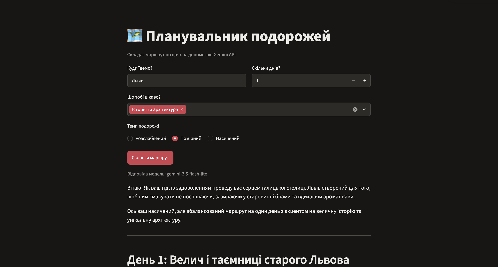
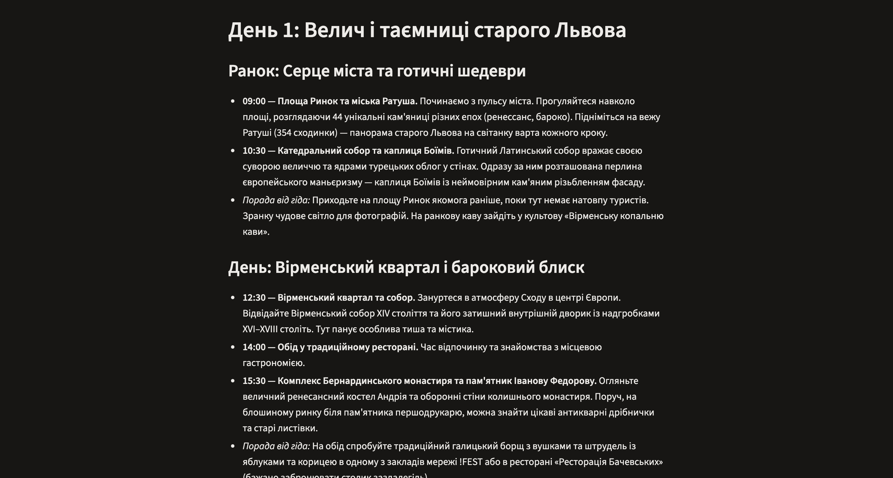

# 🗺️ Планувальник подорожей (Gemini API)

PoC-проєкт для семінару з курсу **«Хмарні обчислення»**.
Веб-застосунок, який за містом, кількістю днів і вподобаннями користувача
складає детальний маршрут подорожі по днях — через **Gemini API** (Google).

Стек: **Python + Streamlit** (інтерфейс) + **google-genai** (клієнт Gemini API).

## Як отримати безкоштовний ключ (без картки)

1. Відкрити **https://aistudio.google.com/apikey**
2. Увійти гугл-акаунтом → **Create API key**.
3. Скопіювати ключ (рядок виду `AIza...`).

> Google AI Studio дає безкоштовний доступ до Gemini API (з лімітами на к-сть
> запитів) — **без прив'язки картки й без білінгу Google Cloud**.

## Запуск

```bash
pip install -r requirements.txt
streamlit run app.py
```

Відкриється сторінка в браузері. Встав ключ у поле ліворуч (або заздалегідь
задай змінну середовища):

```bash
# macOS / Linux
export GEMINI_API_KEY="твій_ключ"
streamlit run app.py
```

## Як це працює

1. Користувач заповнює форму (місто, дні, інтереси, темп).
2. Застосунок будує текстовий запит (prompt) і надсилає його в Gemini API
   (`client.models.generate_content`).
3. Модель повертає готовий маршрут у Markdown, який показується на сторінці
   і який можна завантажити файлом.

## Моделі та обробка помилок

Безкоштовний тариф Gemini API має обмеження за кількістю запитів, а моделі
іноді бувають перевантажені (помилка 503). Тому застосунок пробує моделі по черзі:

| Модель | Запитів/хв | Запитів/день |
|---|---|---|
| `gemini-3.5-flash-lite` (за замовчуванням) | 15 | 500 |
| `gemini-3.1-flash-lite` | 15 | 500 |
| `gemini-3.8-flash` | 5 | 20 |
| `gemini-3.6-flash` | 5 | 20 |

Ліміти безкоштовного тарифу Google офіційно не публікує; у таблиці значення,
заміряні розробниками у вересні–жовтні 2026 р.

- **503 / 429** (перевантаження або ліміт): чекаємо 2 с, потім 4 с і повторюємо, до 3 спроб.
- **404 / 400** (модель недоступна для акаунта): одразу переходимо до наступної моделі.
- **401 / 403** (неправильний ключ): зупиняємось і просимо перевірити ключ.

Модель, яку обрано в бічній панелі, пробується першою, решта залишаються запасними.
Під маршрутом показано, яка модель відповіла.

## Демо




